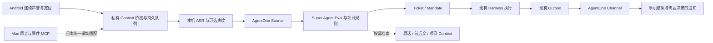

# Android Context → Super Agent：设计与原型状态

目标：用户在现实讨论里交代过的工作，不必进 Session 再打一次字；Agent 从可回查的声音、时间、地点和后续更改里识别工作，执行后主动把结果送回来。

本轮选择：**Android 优先，执行交给现有 DeepSeek Super Agent**。AgentOne 继续是采集和记忆插件，不增加独立 Agent runtime。

## 从一个真实任务出发

“早上我在工位和覃总讨论云端工作台。Agent，把刚才讨论的交互方案整理出来，放到项目里，做完告诉我。”

1. 手机连续保存声音，自动附上采集时间、时区、设备和系统定位。系统录音文件分片不等于对话结束。
2. 本机转写提供原音哈希、逐段原话和偏移。声纹只给出相似度及对应时间窗；地点保留精度与采样时间，不断言人就在某个工位。
3. Super Agent 读取当前片段、同场前后文、已有任务和后续取消，区分明确指令、个人承诺、提议、条件事项与其他人的发言。
4. 在用户为项目启用的规则内生成/继续 Ticket；执行交给现有 Harness Session。任务身份持久化，重新投递不能重复开工。
5. 结果经原有 Outbox → AgentOne Channel → 手机通知。报告区分草稿、测试通过、提交 PR、合并和部署，保留验证依据。
6. 用户可以继续用语音补充、纠正、问进展，不需要选择底层 Session。

## 从官方架构中复用什么

对照官方 `deepseek-ai/dsh-superagent-prototype` 的 `docs/007-architecture.md`、`docs/008-cookbook.md`、`src/sources/kind.ts`、`src/sources/host.ts` 和本机安装版本源码：

| 原有能力 | 本次接法 |
| --- | --- |
| SourceKind / SourceContext.receive | 新增 `agentone-context`，语音成为独立事件来源，不创建 GitHub Issue 搬运私人录音 |
| Trigger / Thread | 原音片段生成稳定 ID；同一设备和录音会话关联到同一 Thread |
| threadContext.read | 模型分页回读前后片段、时间、定位、声纹窗和源哈希，显示缺段 |
| Eval / Policy / Mandate | 模型决定有无任务和任务归属；程序不靠关键词认定 TODO |
| Ticket / Assignment / Harness | 沿用任务、恢复、执行与工作目录机制 |
| SourceChannel / Outbox | 结果按同一消息 ID 幂等写回手机收件箱 |
| 项目 Workspace / Context（本地改版） | 项目身份、执行结果与原始线索可按需检索；不是把所有手机历史塞进提示词 |

官方原型的执行目标仍以一个配置好的仓库为基础。**换掉 GitHub 输入，不等于已把它变成能办理任何生活事项的通用 Agent**。本轮保持既有执行范围；新的外部业务能力由宿主工具和项目规则提供。

## 三个概念分别保存

- **Context**：原始发生记录，包括未识别出待办的讨论；不因没有 TODO 就丢掉。
- **Task candidate**：模型从证据中推断的可能工作，有原话、来源、时间区间、状态和不确定点；可能被忽略、等待或归入已有任务。
- **Mandate / Ticket**：在已配置的项目规则内被接受的工作；执行进度与结果单独持久化，不把模型“说完成了”当验收。

当前实现刻意将所有录音 Trigger 标为 `human:false`，即使用户按了“给 Agent 说一句”也不冒充可信人工消息。采集器需列入 Source 的 `bots`，由 `auto` 模式和已启用规则决定是否执行。这个设计直接复用 Super Agent 的 inferred 授权路径。

“持续记录”中未检测到本人/不确定/未录入声纹的片段保存在桥接库，不进入任务启动路径。检测到本人也仅表示该场存在相似声音，**不能把另一人的一句要求归到本人**。规则必须核对任务原话与本人声音窗、明确指代和后续修正；无法归属时保留上下文或问一个具体问题。跨手机和 Mac 的声纹效果还没有真实校准。

## 最小 Context 数据

| 保留内容 | 用途和边界 |
| --- | --- |
| 原音、SHA-256、片段 ID | 回放、重新识别与核对引用；不只留总结 |
| session_id、sequence、起止时间、时区 | 还原连续讨论与识别缺段；没有文件缺段不证明现实讨论完整 |
| 定位经纬度、accuracy_m、sampled_ms、source | 自动地点线索；失效/拒绝授权保持未知，不要求手填 |
| ASR 模型、逐段文本与原音偏移 | 保存机器识别结果及错误来源；不宣称逐字准确 |
| 声纹状态、匹配区间、profile_id | 筛选可能本人参与的段；不传声纹 embedding |
| intent=ambient / command | 区分被动保存与用户点按钮主动口述，仍由宿主判断任务 |
| 任务依据、取消/替代关系、报告 ID | 把“为什么做”“后来怎么改”和结果连起来；TODO 的执行记录归宿主 |

后续扩展入口：用户分享进来的链接/文件、授权日历、照片中的文档、可选通知内容。**这些尚未实现**；不把读取其他 App 数据伪装成已有系统能力。

长期记忆继续沿用“原始来源 → 可修订结论 → 有效期与替代关系 → 项目任务”的结构。先保留准确线索、精确词与问题式别名，按需要结合时间/地点检索；不把会话总结当唯一记忆，不要求每段声音都生成长期事实。

## 已写成的原型

- Android：API 29+，原生麦克风 AAC，约一分钟自动轮换文件而不中断同一 MediaRecorder；一次开启后用前台服务继续记录。系统通知可暂停。
- 开始记录时请求麦克风、通知和定位权限；拒绝定位保持未知，不填假地址。使用单调时钟推导录音时间，保留系统时区与定位采样时间。
- 本地私有待传队列、自动补传。服务确认持久保存后才清理手机副本；未封装尾段保留待检查，不伪报已经同步。
- 私有 HTTPS 接入；桥接默认只听本机 loopback。手机、ASR worker、Super Agent 各用不同凭据，手机凭据不能伪造转写或结果。
- Node SQLite 桥接：不可变来源、哈希、ASR lease、超时重试、乱序转写不漏投、入站 ACK 和结果幂等。
- 可选离线 faster-whisper worker：显式使用已有本机模型，携带定时转写；显式提供已录入的声纹档案时可比对本人声音，不自动从旧录音挑人。
- Super Agent Cordis Source/Channel 插件：注册、接收、上下文分页、健康状态、规则门控和写回收件箱。未就绪宿主不会接单。
- 原型 APK 已本地编译并验签；原型签名与正式发行签名不同。

## 尚未验收和不能混淆的状态

1. 无连接的 Android 真机，尚未验证真实锁屏、厂商省电策略、分片接续和麦克风质量。APK 构建成功不是连续录音验收。
2. 本轮本机 Super Agent 状态命令返回退出码 1，不能确认运行健康或接单就绪；没有重启它，没有开启 live `auto`，没有派发真实任务。
3. 插件通过本机实际 Super Agent SourceRegistry/Policy 的兼容测试；完整 Harness + LLM + 工具执行没有跑通验收，不能称模型识别待办准确。
4. 结果通知原型是轮询：录音时约 30 秒，停止后 JobScheduler 最短约 15 分钟且受系统调度，可能更晚；尚未接 FCM/厂商 Push，不承诺即时。
5. Android 需要用户在可见 App 中开启麦克风前台服务；重启/杀进程后不能承诺静默自启麦克风。首次授权后锁屏继续录也须真机检查。
6. 尚未把 Mac 的旧音频/事件自动复制到手机桥接库；原有 Mac MCP 保持工作，可作为宿主的检索工具。跨设备场景合并、自动重复声音去重和定位语义地址尚待实现。
7. 手机声纹录入界面尚未实现；原型 worker 可显式复用 Mac 已录入的私人 profile，本人跨设备正负样本准确率未测。
8. 手机没有查询/取消具体 Ticket 的结构化卡片；当前收件箱只呈现宿主原文。取消等语音仍需由模型与宿主规则处理。

## Benchmark 与推进顺序

场景见 `benchmarks/voice-tasks/cases.json`。包含明确请求、想法、取消、他人触发、整场有本人但任务由他人提出、ASR 歧义、重复任务、播放内容注入、条件上线、越界项目和完成状态。

- 自动测试：来源哈希与版本、lease 过期、断网重投、角色隔离、乱序完成、结果幂等、Source/Channel 往返，以及真实宿主规则接口兼容。
- 决策 benchmark：必须提供实际 Super Agent 的 decision 和独立执行/报告证据；没有真实输出就报 `not_run`，不会用预写答案充当准确率。
- 真机验收：至少一次 15 分钟讨论，包括长停顿、跨文件说话、断网恢复、锁屏、他人声音、本人任务和随后取消；对原音、时间线、任务数、实际文件/PR和通知逐项核对。
- 对自动执行更敏感的指标是错误开工率、重复执行率、取消遗漏率与无证据完成率，而不只是 TODO 召回率。首轮小样本目标：这些错误都为 0；这只是验收目标，目前没有实测结果。

下一步顺序：修复/配置现有宿主健康 → 配置私有 HTTPS 与配对 → 真机录音/声纹校准 → 模型真实决策 benchmark → 启用限定项目规则 → 测一次真实交付和手机回报 → 接即时 Push → 增加其他 Context 来源。

本轮命令、结果与未通过项见 [验证记录](../reviews/ANDROID_CONTEXT_20261102.md)。

参考：[官方原型](https://github.com/deepseek-ai/dsh-superagent-prototype)、[Source 扩展契约](https://github.com/deepseek-ai/dsh-superagent-prototype/blob/main/docs/008-cookbook.md)、[Android 麦克风前台服务](https://developer.android.com/develop/background-work/services/fgs/service-types#microphone)。
